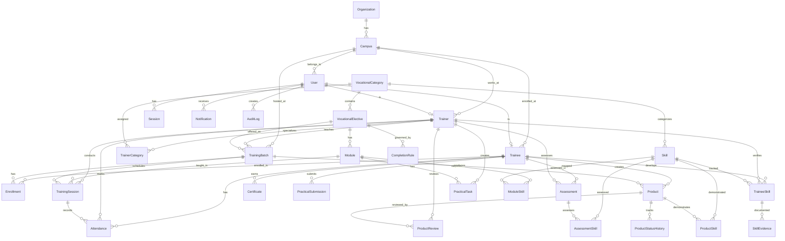

# KISS V-TRACK Database Architecture

## Entity Relationship Overview



## Key Design Decisions

### 1. UUID Primary Keys
All entities use UUID primary keys for security (non-guessable) and distributed generation capability.

### 2. Soft Deletion
Entities like Campus and VocationalCategory use `isActive` flags instead of hard deletion to preserve referential integrity.

### 3. Audit Trail
- `AuditLog` table records all significant actions with user, entity, old/new values
- `ProductStatusHistory` tracks every product status transition
- `Attendance` records include `markedBy` and `markedAt` for accountability

### 4. Many-to-Many Relationships
- Module ↔ Skill via `ModuleSkill`
- Product ↔ Skill via `ProductSkill`
- Assessment ↔ Skill via `AssessmentSkill`
- Trainer ↔ Category via `TrainerCategory`

### 5. Configurable Business Rules
`CompletionRule` table allows admins to configure certificate eligibility per elective, avoiding hard-coded rules.

### 6. Skill Verification Chain
```
TraineeSkill.status: NOT_STARTED → LEARNING → PRACTICING → ASSESSED → VERIFIED
```
Only VERIFIED status is set by an authorized trainer, recorded with `verifiedById` and `dateVerified`.

### 7. Product Lifecycle
```
ProductStatusHistory tracks: IDEA → DESIGN → IN_PROGRESS → SUBMITTED → UNDER_REVIEW → APPROVED → COMPLETED
```

## Indexes

Critical indexes for query performance:
- `users`: email, role, campusId
- `trainees`: studentId, campusId, enrollmentStatus
- `trainers`: employeeId, campusId
- `training_sessions`: batchId, trainerId, date, status
- `attendances`: traineeId, sessionId
- `trainee_skills`: traineeId, skillId, status
- `products`: traineeId, batchId, status
- `certificates`: traineeId, certificateNo, status
- `audit_logs`: userId, entity/entityId, action, createdAt

## Data Integrity

- Foreign keys enforce referential integrity
- Unique constraints prevent duplicate enrollments, skill records
- Composite unique: `(traineeId, batchId)` on Enrollment, `(traineeId, skillId)` on TraineeSkill
- Check constraints via application-level validation (Zod)
